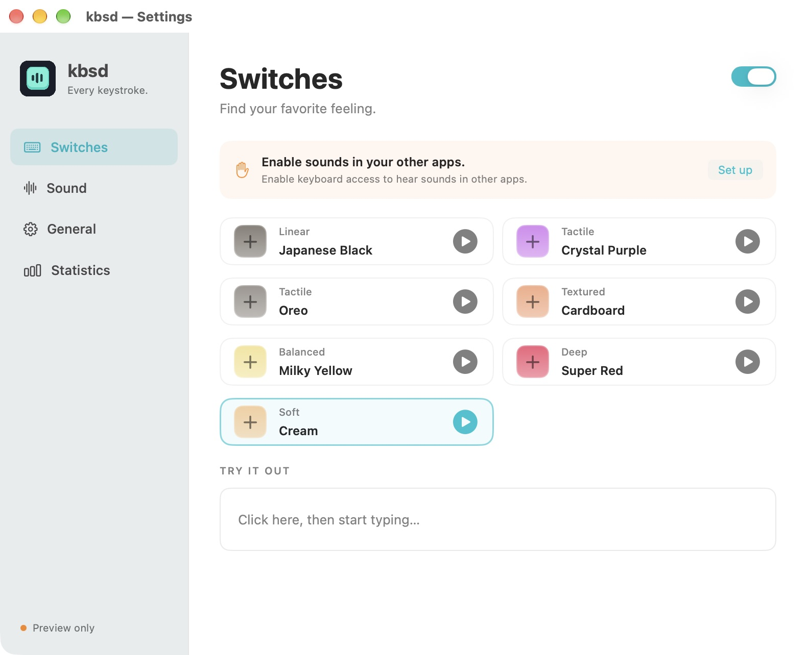

# kbsd

A native keyboard-sound companion for Mac and Windows. Seven sound sets, separate press and release sounds, and a small home in your menu bar or notification area.

**[Website & sound previews](https://kbsd.0xdope.com)** · **[Download the latest release](https://github.com/ackkerman/kbsd/releases/latest)**



## Download

| Platform | Download | Requirements |
| --- | --- | --- |
| Windows installer | [kbsd-v1.0.0-windows-x64-setup.exe](https://github.com/ackkerman/kbsd/releases/download/v1.0.0/kbsd-v1.0.0-windows-x64-setup.exe) | Windows 10/11 x64 |
| Windows portable | [kbsd-v1.0.0-windows-x64.zip](https://github.com/ackkerman/kbsd/releases/download/v1.0.0/kbsd-v1.0.0-windows-x64.zip) | Windows 10/11 x64 |
| macOS | [kbsd-v1.0.0-macos-arm64.zip](https://github.com/ackkerman/kbsd/releases/download/v1.0.0/kbsd-v1.0.0-macos-arm64.zip) | Apple Silicon, macOS 14+ |

On Windows, run the installer, then search for **kbsd** in the Start menu. It installs for the current user and appears in **Settings → Apps → Installed apps** for removal. Launching it again opens the existing tray app's Settings window. Enable **General → Launch at login** if you want it to start when you sign in; installation does not turn this on automatically.

The portable ZIP remains available: extract the entire folder and run `kbsd.exe`, keeping `Sounds/` and the runtime files alongside it. Both Windows downloads include .NET and all original recordings, require no administrator access, and are not Authenticode signed. See [Windows setup and build instructions](windows/README.md).

Windows artifacts were added to the existing v1.0.0 release; their matching source revisions are linked in the release notes. The original macOS archive, portable ZIP and tag are retained. Use `SHA256SUMS-all.txt` in the release to verify downloads; `SHA256SUMS-setup.txt` also covers the installer and the original `SHA256SUMS.txt` remains available for the macOS archive.

On macOS, unzip `kbsd-v1.0.0-macos-arm64.zip` and move `kbsd.app` to Applications.

- Apple Silicon, macOS 14 or later.
- This release uses a fixed local code-signing certificate and is **not Developer ID signed or notarized**. macOS may show a security warning. Review the source and [Apple's guidance](https://support.apple.com/en-us/102445) before opening it.
- In kbsd, open **General → Open System Settings**, then allow kbsd in Accessibility (called **Device Control & Data Access** on some macOS versions).
- In-app sound previews work without keyboard access. Other-app typing requires it.
- If a previous development build is already allowed but kbsd still says **Preview only**, remove that old permission entry, add the current app, and click **Check again**.

## Features

- Seven sound sets: Japanese Black, Crystal Purple, Oreo, Cardboard, Milky Yellow, Super Red, and Cream.
- Independent down/up sounds with overlapping playback.
- Volume, pitch, subtle random pitch, and stereo width.
- Optional modifier-key and mouse-click sounds.
- Screen-lock mute, local preferences, daily/lifetime counts, and optional launch at login.
- No account, network requests, typed-character collection, or keystroke history in the native app.

The sound bank uses 13 sample key pairs per set; other physical keys reuse samples from the same set. Stereo width uses panning, not head-tracked spatial audio. Automatic updates and an Intel download are not included.

## Build

Requires Node.js 22.6+. On macOS, also install Xcode command-line tools with Swift 6+ and Python 3. On Windows, install .NET 10 SDK and PowerShell 7.

```sh
npm ci
make check
make native-run
```

`make check` runs web formatting/types/tests/build and the current platform's native formatting/tests/audio diagnostics. On macOS it produces `dist/kbsd.app`; on Windows it checks the Windows Forms app. Both diagnostic paths schedule all 182 recordings through the playback mixer and check finite, non-silent output.

```powershell
make windows-run       # Windows settings and tray
make windows-package   # dist/windows/ZIP + SHA256SUMS.txt
make windows-installer # ZIP + Setup EXE + SHA256 (requires Inno Setup 6.3+)
```

```sh
make release   # dist/release/ZIP + SHA256SUMS.txt
```

Verify a downloaded ZIP with `shasum -a 256 -c SHA256SUMS.txt` in the download directory.

## Landing page

```sh
npm run dev -- --host 0.0.0.0 --port 4173
npm run build
```

The static output is `dist/client`. Cloudflare Pages deployment:

```sh
wrangler pages deploy dist/client --project-name kbsd --branch main
```

## Source and assets

See [ATTRIBUTION.md](ATTRIBUTION.md) for asset provenance. The recordings are from Klack’s sound previews and included with permission; their original rights holders retain ownership. Icon artwork and the landing page are specific to kbsd. Original website images and source code are not included.

No license has been specified for first-party code or assets. Public availability does not itself grant reuse rights. Dependencies retain their own licenses.

## Keep keyboard permission across local updates

Use the same code-signing identity for successive builds. See [native/SIGNING.md](native/SIGNING.md) for setup and validation. After a fixed identity is configured, builds refuse to silently fall back to ad-hoc signing. The transition from an older ad-hoc build may require one final permission re-registration.
